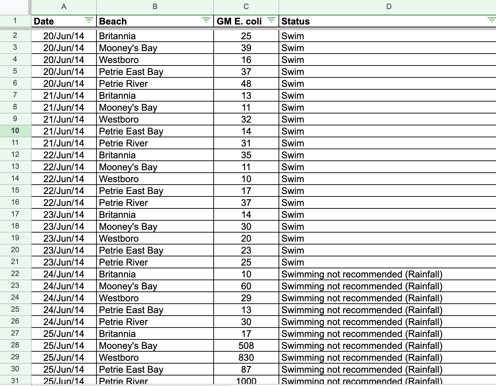
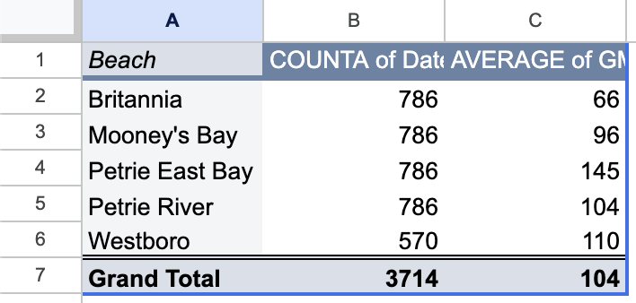
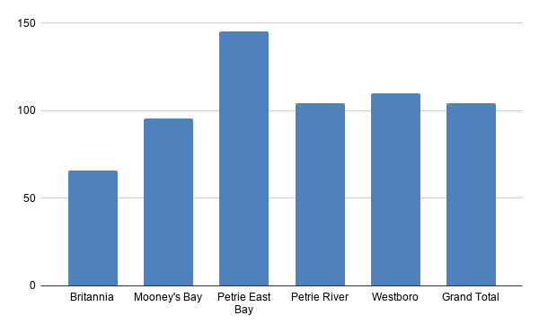

**November 5, 2026** 
**MPAD2003A Introductory Data Storytelling** 
**Lucas Sayeau** 
**Presented to Jean-Sébastien Marier** 

# Deliverable 2: Exploratory Data Analysis (EDA)

## 1. Getting Data

Dataset: [Beach Water Sampling (City of Ottawa)](https://open.ottawa.ca/documents/beach-water-sampling)

Google Sheets: [Beach Water Sampling spreadsheet](https://docs.google.com/spreadsheets/d/1YXj0S1sWDgQpiIxDm3s21EvZv7pSl85NETxXagml57A/edit?usp=sharing)

This is a City of Ottawa dataset from Ottawa Public Health about E. coli testing at 5 beaches, which I'll be using for my story on the switch from daily to weekly testing. I downloaded the .xlsx from Open Ottawa and imported it with file, import, upload, replace spreadsheet.

 
*Figure 1: The Beach Water Sampling dataset in Google Sheets just after importation.*

### Size:

This dataset has 3714 rows of data and 4 columns (Date, Beach, GM E. coli, Status), and it runs from June 20, 2014 to August 25, 2026. Row 1 is empty, and the headings are in row 2. The data is not fully clean, as the GM E. coli column has 93 empty cells, plus "Not Open" or "-" typed in 26 times. The status column also spells the same thing in multiple different ways ("Swim", "swim", " Swim").

### Date column:

This column holds dates. There are 290 to 360 rows per year from 2014 to 2024, then only 70 in 2025 and 75 in 2026, due to the fact that Ottawa Public Health switched from daily to weekly testing.

### Beach and GM E. coli columns:

The "Beach" variable is nominal and names 5 different beaches (Britannia, Mooney's Bay, Westboro, Petrie River, Petrie East Bay), with "Westboro" not having any data during 2022 to 2024. GM E. coli is a continuous variable on a ratio scale, measured in E. coli per 100 mL (Statistics Canada, 2021). Its values run from 9 to 1000, with a median of 45, and 472 results are 200 or higher, which fails the provincial standard.

### My question:

How many unsafe days would weekly testing have missed during the years when testing was daily?

## 2. Understanding Data

### 2.1. VIMO Analysis

**Valid**

All 3,714 dates are valid, 3,595 of the GM E. coli cells hold proper numbers, and all 5 beach names are correct.

**Invalid**

The GM E. coli column has text typed into a number column: "Not Open" 12 times (2017, at Petrie East Bay and Petrie River) and "-" 14 times (2025–2026). The Status column uses 22 different spellings for about 6 categories, like "Swim", "swim" and " Swim". 108 Status values and 6 Beach names have extra spaces.

**Missing**

GM E. coli has 93 empty cells: Britannia's entire 2020 season (65), plus Petrie East Bay (14) and Petrie River (14) in 2019. Status has 14 empty cells, and Westboro has no rows at all for 2022 to 2024.

**Outliers**

The GM E. coli median is 45 and the mean is 104.2. 14 values are exactly 1,000, which is probably a cap on the lab's measurement and not a real count, for example Petrie River on July 15, 2016.

### 2.2. Cleaning Data

**Method 1: Deleting the empty row and freezing the headings**

I deleted the empty row 1 so the headings sit in row 1, then froze that row with View, Freeze, 1 row so the headings stay visible while scrolling.

**Method 2: Trimming whitespace**

I selected the Beach and Status columns and used Data, Data cleanup, Trim whitespace. This fixed 108 Status values and 6 Beach names with extra spaces, so Beach went back to exactly 5 names and Status went from 22 spellings to 11.

**Method 3: Find and replace**

I used Edit, Find and replace with "Match case" ticked to fix capitalization: "swim" became "Swim" (302 cells), "Swimming Not Recommended" became "Swimming not recommended" (2 cells), and "(rainfall)" became "(Rainfall)" (48 cells). Status went from 11 spellings down to 8.

 
*Figure 2: The Beach Water Sampling dataset after cleaning.*

### 2.3. Analyzing Data

**Pivot table**

I made a pivot table with Beach as rows, COUNTA of Date to count the records per beach, and AVERAGE of GM E. coli. I chose these variables to compare water quality between the 5 beaches.

 
*Figure 3: Pivot table showing the number of records and average E. coli level per beach.*

Petrie East Bay has the highest average at 145.0 E. coli per 100 mL, more than double Britannia's 65.9. The others fall in between: Westboro 109.8, Petrie River 104.0, Mooney's Bay 95.7. Every beach has 786 records except Westboro with 570, because of its missing 2022–2024 seasons.

**Exploratory chart**

I made a column chart from the pivot table because column length makes the gap between beaches easy to compare.

 
*Figure 4: Average E. coli level per beach, 2014–2026.*

**Failing results**

I counted failing results (200 or higher) per beach with COUNTIFS:

    =COUNTIFS(B:B, "Petrie East Bay", C:C, ">=200")

Petrie East Bay failed 170 times, about 22% of its tests, while Britannia failed 47 times (6.5%). Mooney's Bay failed 94 times, Petrie River 91 and Westboro 70, all around 12%. 472 results failed in total.

**Potential story**

The story is how many of these failures weekly testing would miss, especially at Petrie East Bay, the beach that fails most often. The next step is to compare daily and weekly results from the years when testing was daily.

## 3. Delivering Data

To tell this story, I would need to re-run the daily results from 2014–2024 as if they were tested weekly, to count how many failing days a weekly schedule would have missed. I would also need rainfall data, since many of the "Swimming not recommended (Rainfall)" results line up with storms.

I could interview Matthew Ruf at Ottawa Public Health about why testing went weekly, and Richard Kibbee at Carleton University about what weekly testing can miss. A regular swimmer at Petrie Island would also add a citizen's view.

These sources provide strong context:

* [CTV News Ottawa (May 20, 2025): Water at Ottawa's 4 public beaches will not be tested daily this summer](https://www.ctvnews.ca/ottawa/article/water-at-ottawas-4-public-beaches-will-not-be-tested-daily-this-summer/)
* [Ottawa Riverkeeper (September 2025): Water quality analysis of OPH beaches](https://ottawariverkeeper.ca/wp-content/uploads/2025/09/OttawaRiverkeeper_WQAnalysis_OPHBeaches_Sept2025.pdf)

CTV reported the switch to weekly testing, and Riverkeeper analyzed 2014–2024 OPH data to show what weekly testing would miss.

## 4. References

Ottawa Riverkeeper. (2025). *Water quality analysis of Ottawa Public Health beaches*. [https://ottawariverkeeper.ca/wp-content/uploads/2025/09/OttawaRiverkeeper_WQAnalysis_OPHBeaches_Sept2025.pdf](https://ottawariverkeeper.ca/wp-content/uploads/2025/09/OttawaRiverkeeper_WQAnalysis_OPHBeaches_Sept2025.pdf)

Pringle, J. (2025, May 20). Water at Ottawa's 4 public beaches will not be tested daily this summer. *CTV News Ottawa*. [https://www.ctvnews.ca/ottawa/article/water-at-ottawas-4-public-beaches-will-not-be-tested-daily-this-summer/](https://www.ctvnews.ca/ottawa/article/water-at-ottawas-4-public-beaches-will-not-be-tested-daily-this-summer/)

Statistics Canada. (2021). *Statistics: Power from data!* [https://www150.statcan.gc.ca/n1/edu/power-pouvoir/toc-tdm/5214718-eng.htm](https://www150.statcan.gc.ca/n1/edu/power-pouvoir/toc-tdm/5214718-eng.htm)

**AI disclosure:** Only used "Claude" once to figure out the steps on how to create charts through the Google sheets interface itself.