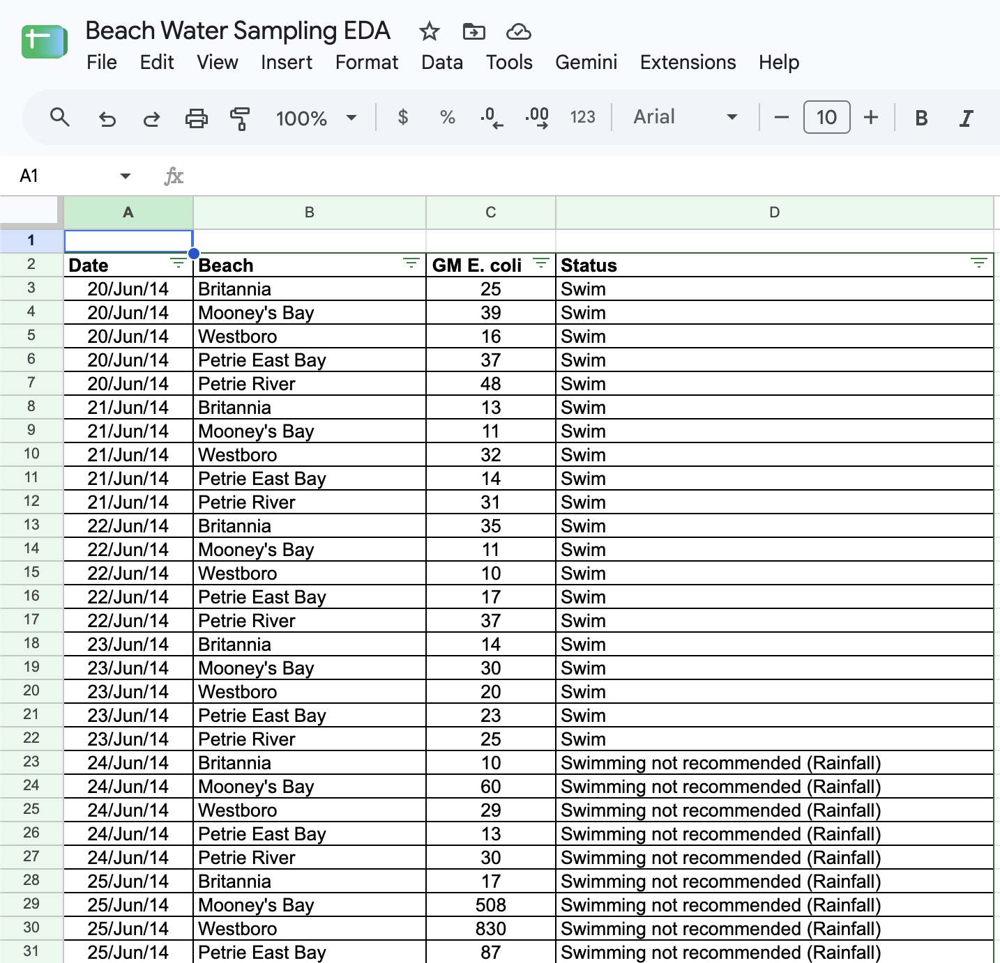

**November 4, 2026** 
**MPAD2003A Introductory Data Storytelling** 
**Lucas Sayeau** 
**Presented to Jean-Sébastien Marier** 

# Deliverable 2: Exploratory Data Analysis (EDA)

Use one hashtag symbol (`#`) to create a level 1 heading like this one.

## Foreword

For this assignment, you must clean and analyze the dataset from Deliverable 1, create exploratory charts/visualizations, and identify a potential story. Your assignment must clearly detail your process. You are expected to write about 1,000-1,200 words, and to include several screen captures showing the different steps you went through. Your assignment must be written with the Markdown format and submitted on GitHub.

I have been assigning different versions of this project to my digital journalism and data storytelling students for a few years now. Its structure was inspired by the main sections/chapters of [*The Data Journalism Handbook*](https://datajournalism.com/read/handbook/one/). This version was further inspired by the [Key Capabilities in Data Science](https://extendedlearning.ubc.ca/programs/key-capabilities-data-science) program offered by the University of British Columbia (UBC).

**Here are some useful resources for this assignment:**

* [GitHub's *Basic writing and formatting syntax* page](https://docs.github.com/en/get-started/writing-on-github/getting-started-with-writing-and-formatting-on-github/basic-writing-and-formatting-syntax)
* [The template repository for this assignment in case you delete something by mistake](https://github.com/jsmarier/jou4100_jou4500_mpad2003_project2_template)

Did you notice how to create a hyperlink? In Markdown, we put the clickable text between square brackets and the actual URL between parentheses.

And to create an unordered list, we simply put a star (`*`) before each item.

## 1. Getting Data

Dataset: [Beach Water Sampling (City of Ottawa)](https://open.ottawa.ca/documents/beach-water-sampling)

Google Sheets: [Beach Water Sampling spreadsheet](https://docs.google.com/spreadsheets/d/1YXj0S1sWDgQpiIxDm3s21EvZv7pSl85NETxXagml57A/edit?usp=sharing)

This is a City of Ottawa dataset from Ottawa Public Health about E. coli testing at 5 beaches, which I'll be using for my story on the switch from daily to weekly testing. I downloaded the .xlsx from Open Ottawa and imported it with file, import, upload, replace spreadsheet.

 
*Figure 1: The Beach Water Sampling dataset in Google Sheets just after importation.*

### Size:

This dataset has 3714 rows of data and 4 columns (Date, Beach, GM E. coli, Status), and it runs from June 20, 2014 to August 25, 2026. Row 1 is empty, and the headings are in row 2. The data is not fully clean, as the GM E. coli column has 93 empty cells, plus "Not Open" or "-" typed in 26 times. The status column also spells the same thing in multiple different ways ("Swim", "swim", " Swim").

### Date column:

This column holds dates. There are 290 to 360 rows per year from 2014 to 2024, then only 70 in 2025 and 75 in 2026, due to the fact that Ottawa Public Health switched from daily to weekly testing.

### Beach and GM E. coli columns:

The "Beach" variable is nominal and names 5 different beaches (Britannia, Mooney's Bay, Westboro, Petrie River, Petrie East Bay), with "Westboro" not having any data during 2022 to 2024. GM E. coli is a continuous variable on a ratio scale, measured in E. coli per 100 mL (Statistics Canada, 2021). Its values run from 9 to 1000, with a median of 45, and 472 results are 200 or higher, which fails the provincial standard.

### My question:

How many unsafe days would weekly testing have missed during the years when testing was daily?

## 2. Understanding Data

### 2.1. VIMO Analysis

Use three hashtag symbols (`###`) to create a level 3 heading like this one. Please follow this template when it comes to level 1 and level 2 headings. However, you can use level 3 headings as you see fit.

Insert text here.

Support your claims by citing relevant sources. Please follow [APA guidelines for in-text citations](https://apastyle.apa.org/style-grammar-guidelines/citations).

**For example:**

As seen in Bounegru & Gray (2011), a data visualization should be clear...

### 2.2. Cleaning Data

Insert text here.

### 2.3. Analyzing Data

Insert text here.

**This section should include a screen capture of your pivot table, like so:**

 
*Figure 2: This pivot table shows...*

**This section should also include a screen capture of your exploratory chart, like so:**

 
*Figure 3: This exploratory chart shows...*

## 3. Delivering Data

Insert text here.

## 4. References

Statistics Canada. (2021). *Statistics: Power from data!* [https://www150.statcan.gc.ca/n1/edu/power-pouvoir/toc-tdm/5214718-eng.htm](https://www150.statcan.gc.ca/n1/edu/power-pouvoir/toc-tdm/5214718-eng.htm)

**Here's an example:**

Bounegru, L., & Gray, J. (Eds.). (2021). *The Data Journalism Handbook 2: Towards A Critical Data Practice*. Amsterdam University Press. [https://ocul-crl.primo.exlibrisgroup.com/permalink/01OCUL_CRL/hgdufh/alma991022890087305153](https://ocul-crl.primo.exlibrisgroup.com/permalink/01OCUL_CRL/hgdufh/alma991022890087305153)
